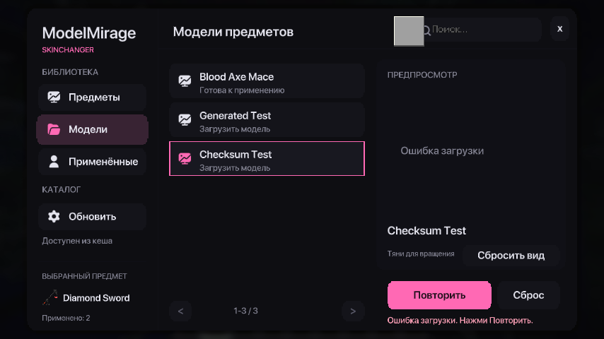

# Проверка ModelMirage 0.2.0

Среда: Minecraft 26.2, Fabric Loader 0.19.5, Fabric API 0.161.0+26.2,
OpenJDK 25, Linux/Xvfb/llvmpipe. Проверено 2026-10-01.

## Автоматические проверки

- `./gradlew build --no-daemon`: успешно. В моде нет автоматических unit tests (`test NO-SOURCE`).
- В репозитории каталога `python scripts/validate_catalog.py`: 1 модель, успешно.
- `python -m unittest discover -s tests -v`: 5/5 успешно. Покрыты валидный каталог, SHA-256, path traversal, отсутствующая texture dependency и duplicate ID.
- [GitHub Actions](https://github.com/hhhhhffd/ModelMirage-catolog/actions/runs/36901356053): успешно.
- Remote `main` каталога совпадает с коммитом `86eb034a8e8b64dbfa36e7b993f8afb5884974e5`.
- Проверено содержимое JAR: runtime loader, mixins, MSDF shader/fonts и notices включены; JSON/PNG Blood Axe Mace не включены.

## Проверка в клиенте

Скриншоты получены через Minecraft Mod MCP 0.4.1 (`screenshot_to_file`).
Из-за неработающего input hook этой версии MCP ввод выполнялся через
`xdotool`, с просмотром скриншотов и логов после каждого сценария.

| Сценарий | Результат |
| --- | --- |
| Right Shift → поиск `diamond_sword` → выбор предмета → модель | Меню открывается, поиск и переход работают |
| Blood Axe Mace из опубликованного GitHub-каталога | JSON и PNG проверены, runtime atlas создан, 948 faces |
| Preview: drag, scroll, сброс ракурса | Модель вращается и масштабируется; отдельный oversized render обеспечивает чёткий preview |
| Применить / Сброс | Меняется только изображение; sword остаётся sword, выбор записан в config |
| Mace и diamond sword одновременно | Один выбранный runtime model отображается на обоих типах предметов |
| Отдельная fixture с `minecraft:item/generated` | Загружена динамически, 1174 faces, без нового resource reload |
| Неверный SHA-256 fixture | Загрузка отклонена, кнопка Повторить выполняет новый запрос, Apply недоступен |
| Исправление записи и Обновить | Новая ревизия загружается, preview и Apply восстанавливаются |
| Нет файла в кеше, сервер недоступен | Показана ошибка; preview другой модели не выдаётся за выбранную |
| F3+T после загрузки модели | Runtime texture/model остаются доступны |
| Остановка localhost HTTP server → Обновить | Используется локальный индекс, UI показывает «Доступен из кеша» |
| Полное закрытие и запуск с остановленным HTTP server | Выбор и модель восстановлены из кеша; `ConnectException` приводит к fallback |

Тестовые generated/checksum записи использовались только в локальном
каталоге на `127.0.0.1:18762`. В опубликованном каталоге их нет.

До ручного F3+T в логах был единственный `Reloading ResourceManager` —
начальная загрузка Minecraft. Применение моделей не вызывало reload.

Серый квадрат поверх поля поиска на dev-скриншотах — overlay Minecraft Mod
MCP с отсутствующим icon resource. MCP не входит в релиз ModelMirage.
Предупреждения Realms/authentication, OpenAL/flite и Xvfb cursor относятся
к среде разработки; исправлений этих внешних компонентов не выполнялось.

## Повторная проверка агентом

1. `./scripts/setup-mcp.sh` и `./gradlew runClient`.
2. Открыть отдельный тестовый мир с cheats, выдать `mace` и `diamond_sword`.
3. Right Shift → предмет → Blood Axe Mace → preview → Применить.
4. Сделать MCP screenshot, проверить модель в hotbar и руке, затем Сброс.
5. Проверить `run/logs/latest.log`: runtime model ready, без дополнительного resource reload.
6. Для проверки кеша указать localhost каталог через JVM option `-Dmodelmirage.catalogUrl=...`, загрузить модель, остановить HTTP server и полностью перезапустить клиент с тем же URL.
