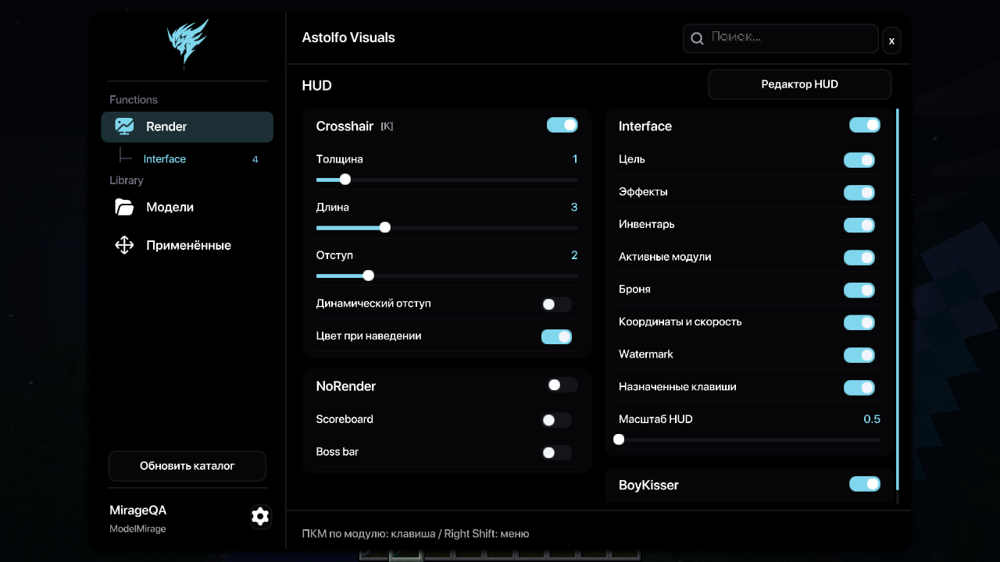
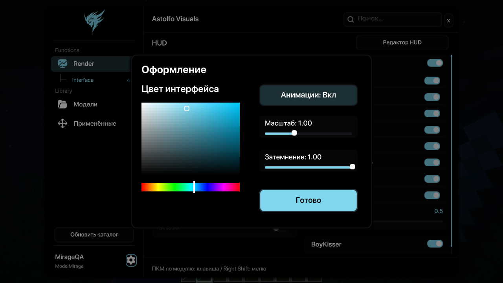
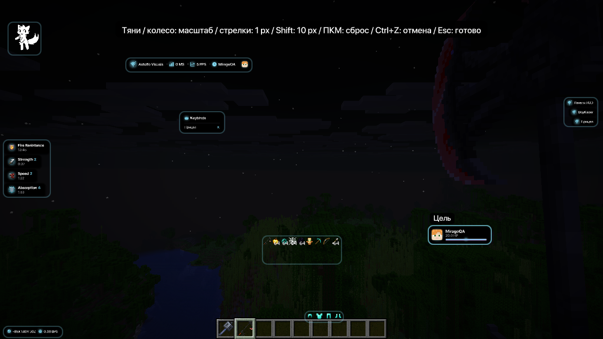
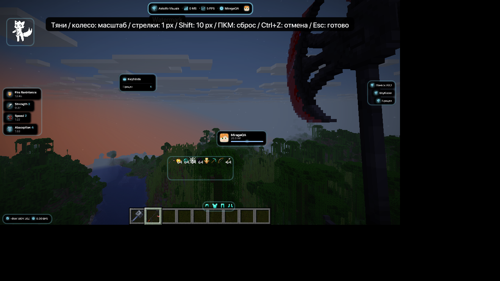
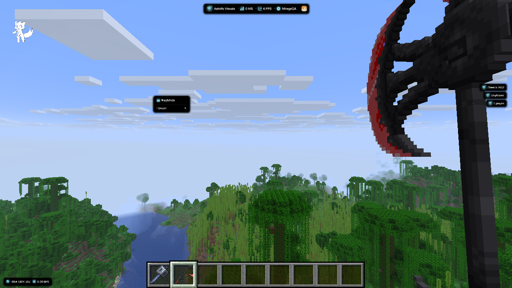
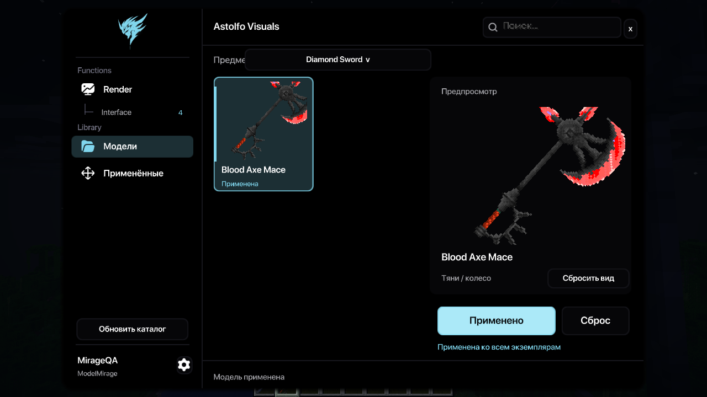
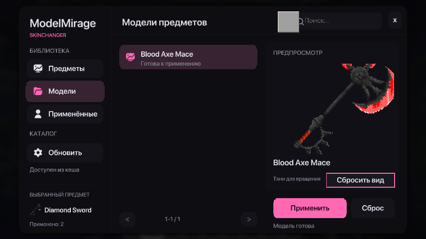
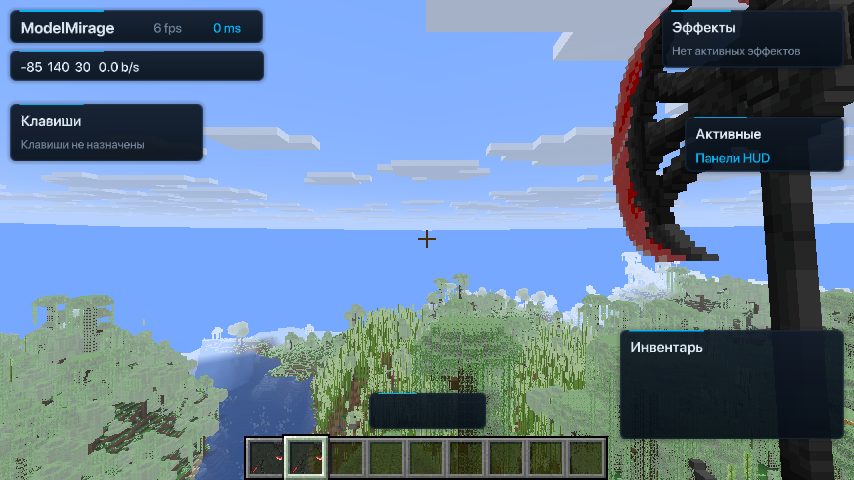

# Проверка ModelMirage 0.3.0

Среда: Minecraft 26.2, Fabric Loader 0.19.5, Fabric API 0.161.0+26.2,
OpenJDK 25, Linux/Xvfb/llvmpipe. Проверено 2026-10-02.

## Перенос HUD и GUI AstolfoVisuals — 2026-10-03

Источник: AstolfoVisuals `13ca7da2a789c45a45b9c5c3eea7bb200b00ea2f`.
Minecraft 26.2 / JDK 25 / Fabric 0.161.0+26.2, Linux/Xvfb/llvmpipe.
Проверка выполнялась через xdotool и снимки Xvfb в отдельной копии мира
`/tmp/modelmirage-astolfo-qa`; исходные настройки и мир в `run/` не менялись.

- `./gradlew build --offline --no-daemon` с JDK 25: успешно.
- `git diff --check`: успешно. Unit tests отсутствуют (`test NO-SOURCE`).
- Right Shift открывает чёрный ClickGui с оригинальным логотипом, шрифтами,
  иконками, двумя колонками модулей и встроенными настройками.
- ЛКМ включает Crosshair; ПКМ назначает K. Назначение и включённое состояние
  восстановились после перезапуска клиента, Keybinds показывает реальную клавишу.
- Редактор показывает голову игрока и HP, иконки эффектов, образцы предметов
  и брони без фона, watermark, BoyKisser и список активных модулей.
- Target HUD перетащен: `x=0.71171874`, `y=0.66944444`; колесо сохранило
  `scale=1.05`. Ctrl+Z отменил последующее смещение с сохранением масштаба.
- В чате watermark перетащен на `x=0.21015625`, `y=0.1736111`.
  После полного перезапуска восстановилось это положение; запись watermark
  без поля `scale` прочитана со значением 1. Target HUD восстановился с масштабом 1.05.
- ПКМ сбросил обе панели: их записи удалены из `hud.json`.
- Изменение окна 1280×720 → 1024×576: HUD остаётся в границах окна,
  размер текста и предметов сохраняется, относительные позиции пересчитаны.
- GUI scale 3: HUD и ClickGui отображаются и принимают клики. ArrowRight
  изменил x с `0.553125` на `0.55390567`, то есть ровно на 1 физический пиксель.
  Проверено после исправления целочисленного деления в расчёте масштаба.
- Выдан настоящий Fire Resistance: отдельная карточка с правильной иконкой
  и убывающим таймером; ванильный список эффектов скрыт.
- Шестерёнка открывает окно оформления поверх GUI. Выключение анимаций
  сохранилось в `appearance.json`, Esc вернул в меню.
- Модели → Blood Axe Mace → Применить: 3D preview работает, кнопка показывает
  «Применено», выбор сохранён. В логе `948 faces, no resource reload`.

Ограничения: multiplayer и отдельные сценарии урона/поглощения не проверялись.
В llvmpipe клиент работал примерно с 4–5 FPS, поэтому плавность анимаций на GPU
этой средой не подтверждается. В логах есть прежние ошибки OpenAL, flite,
Realms/authentication и Xvfb cursor; завершение окна X11 даёт ненулевой exit code.
Ошибок загрузки HUD-ресурсов, GUI shaders или обработки ввода не обнаружено.

## Сборка и состав JAR

- `./gradlew build --no-daemon`: успешно. Автоматических unit tests в моде нет (`test NO-SOURCE`).
- Проверен состав `ModelMirage-0.3.0.jar`: GUI shaders/fonts, HUD, модельный загрузчик и notices включены.
- Остались четыре HUD-модуля: Crosshair, Interface, NoRender (только scoreboard/boss bar), BoyKisser.
- Mixins: три исходных для runtime-моделей и KeyboardVisualMixin для клавиш HUD.
- Удалены world/player/effect renderers, шейдеры рук и предметов, связанные mixins и ресурсы.
- MusicService, music-bridge, MediaPlayerInfo и вложенных библиотек в релизе нет.
- Blood Axe Mace JSON/PNG загружаются из каталога и не включены в JAR.
- `git diff --check`: успешно.

## Проверка в Minecraft

Скриншоты сделаны установленным Minecraft Mod MCP 0.4.1 через
`screenshot_to_file`. Его input hook не управляет GUI; нажатия и клики
выполнялись через `xdotool` в отдельном тестовом клиенте.

| Сценарий | Результат |
| --- | --- |
| Right Shift | Открывается нативное меню с разделами Модели / Применённые / HUD |
| Blood Axe Mace на diamond sword | Выбор и preview восстановлены, модель отображается в руке и hotbar |
| Сброс / Применить в новом меню | Запись для diamond sword удаляется и восстанавливается; подмена mace сохраняется |
| Runtime loader | В логе 948 faces, без нового resource reload |
| HUD → модуль → переключатели панелей | Состояния меняются, настройки автоматически сохраняются |
| Панели в мире | Реальные FPS/ping, координаты, инвентарь, броня и список активных модулей |
| Редактор HUD | Панели выбираются и перетаскиваются; положение записано в hud.json |
| Esc из редактора HUD | Возврат в прежнее меню |
| Оформление → анимации, масштаб | Значения меняются, записаны в appearance.json; Esc возвращает в меню |
| Полный перезапуск клиента | HUD-настройки и подмена модели восстановлены |

## Ограничения проверки

В этой проверке не создавались отдельные multiplayer-серверы. Boss bar /
scoreboard suppression и параметры прицела проверены сборкой и подключением
Fabric HUD registry, без отдельных игровых сценариев. Проверки загрузчика
каталога (checksum, generated items, offline fallback, F3+T) выполнены при
подготовке 0.2.0; его код в 0.3.0 не менялся.

При закрытии тестового клиента Minecraft Mod MCP 0.4.1 оставляет
HTTP-Dispatcher и pool threads; shutdown watchdog создаёт crash report.
В его JAR обнаружен McpHttpServer, использующий JDK HttpServer; связь
зависания с MCP следует из оставшихся потоков. MCP не входит в релиз.
Предупреждения Realms/authentication, OpenAL/flite и Xvfb cursor относятся
к среде разработки. Серый overlay в верхнем углу создаёт dev-мод MCP.

## Повторная проверка агентом

1. `./scripts/setup-mcp.sh` и `./gradlew runClient`.
2. Открыть отдельный тестовый мир с cheats, выдать `mace` и `diamond_sword`.
3. Right Shift → Модели → выбрать предмет → Blood Axe Mace → preview → Применить / Сброс.
4. HUD → Панели HUD → включить панели; открыть Редактор HUD, перетащить панель и нажать Esc.
5. Проверить Оформление, сохранение и восстановление после перезапуска.
6. Сделать MCP screenshots, проверить `run/logs/latest.log` и отсутствие resource reload при выборе модели.
