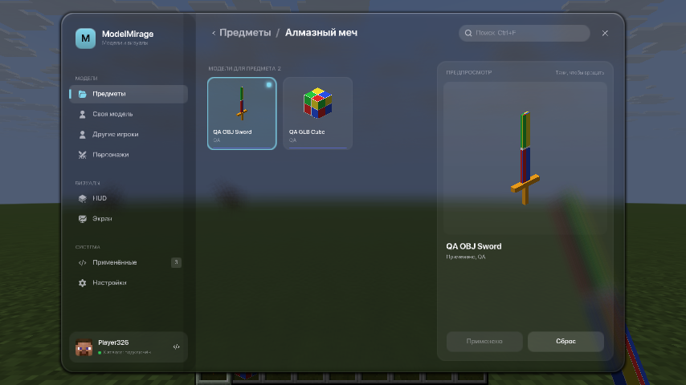
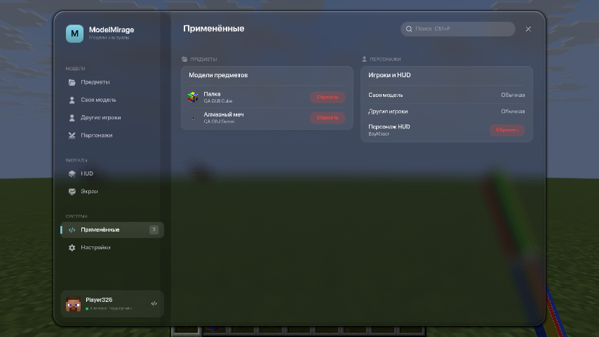
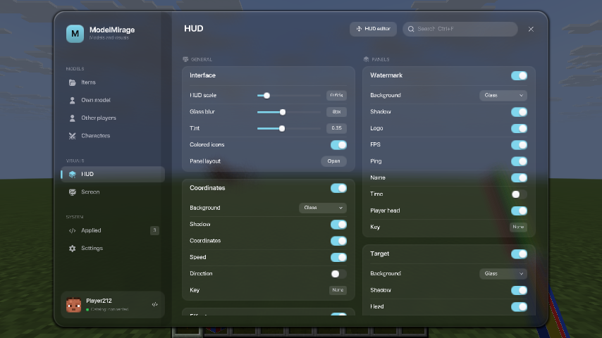
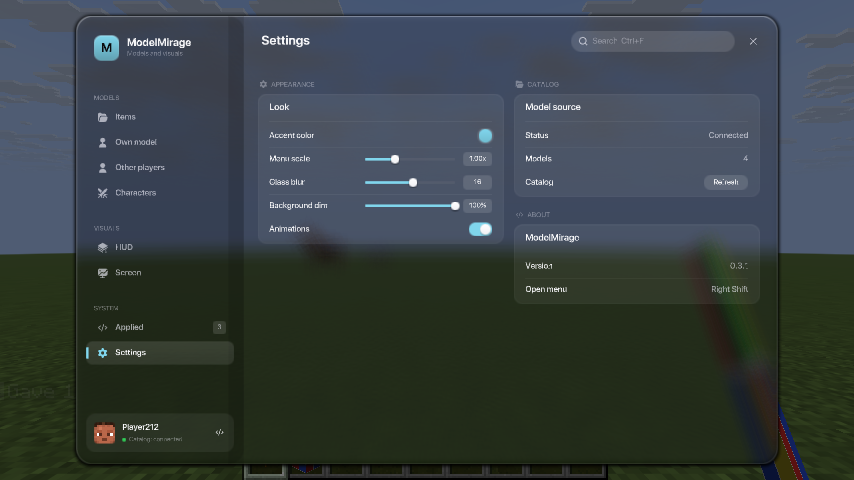
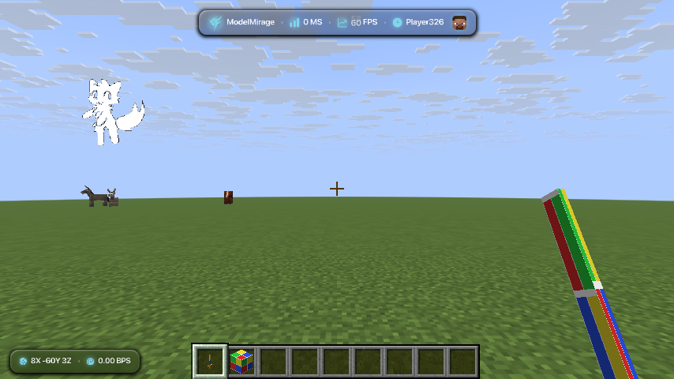

# Проверка ModelMirage

## Автоматические тесты

```bash
JAVA_HOME=/usr/lib/jvm/java-25-openjdk ./gradlew test
```

JUnit 5 + `fabric-loader-junit`: тесты запускаются внутри Fabric Loader, поэтому
им доступны классы Minecraft (Identifier, NativeImage) и нативный Assimp.
Сеть и GPU не нужны. Рабочая папка тестов — `build/test-run`. `./gradlew build`
тоже запускает тесты.

| Класс | Тестов | Что проверяет |
| --- | ---: | --- |
| `CatalogParserTest` | 106 | индекс каталога: schema 1/2, значения по умолчанию, встроенный персонаж, все правила отказа (пути с `..` и `/`, SHA-256, размеры и суммарный лимит, число записей и файлов, id, kind, цвет) |
| `CatalogFilesTest` | 12 | SHA-256, проверка кеша (битый объект, неверный размер), атомарная запись, очистка неиспользуемых файлов, размер записи |
| `AssimpSceneTest` | 35 | OBJ+MTL (имя без учёта регистра, текстура, `Kd`, `d`), триангуляция, UV, GLB со встроенной PNG, песочница (`/etc/passwd`, `../`, `file://`, `C:/`), мусор в 9 форматах, лимит 100 000 треугольников, NaN/Inf |
| `AssimpModelsTest` | 26 | список форматов, вписывание в блок, выбор текстуры материала |
| `MascotAnimationsTest` | 21 | границы размера, интервала и числа кадров, битые и лишние PNG |
| `RuntimeModelsTest` | 16 | проверка PNG до декодирования: сигнатура, IHDR, размеры |
| `ItemModelOverridesTest` | 29 | чтение и запись `modelmirage.json`, старый id Blood Axe Mace, отказ на неверных записях |
| `CosmeticSelectionsTest` | 23 | `changer.json`, перенос `builtin-boykisser` → `builtin-mascot` |
| `HudLayoutTest` | 11 | `hud.json`: ограничение позиций и масштаба, перенос `boykisser` → `mascot` в любом порядке ключей |
| `VisualsMigrationTest` | 3 | перенос модуля `BoyKisser` → `Mascot` без затирания нового |
| `LangFilesTest` | 8 | `en_us` и `ru_ru`: одинаковые ключи, одинаковые `%s`/`%d`, нет кириллицы в английском, все ключи из кода и `modules.json` переведены, лишних нет |

Итого 290 тестов, около 2 секунд (2026-10-12, Linux x64, JDK 25).

Без GPU и игрового окна не проверяются: запекание квадов и установка атласа
(`MeshGeometry.bake`, `Prepared.install`), сетевые запросы каталога, отрисовка
меню и HUD. Для них ниже ручной сценарий.

## Ручная проверка в игре

1. Собери тестовый каталог и запусти локальный сервер:

   ```bash
   python3 scripts/qa-catalog.py /tmp/mm-catalog
   cd /tmp/mm-catalog && python3 -m http.server 8765 --bind 127.0.0.1
   ```

   В нём OBJ-меч с MTL и PNG (оранжевая гарда задана только цветом), GLB-куб
   со встроенной PNG и тот же OBJ как модель игрока.
2. Запусти клиент с этим каталогом:

   ```bash
   JAVA_HOME=/usr/lib/jvm/java-25-openjdk \
   JAVA_TOOL_OPTIONS=-Dmodelmirage.catalogUrl=http://localhost:8765/index.json \
   ./gradlew runClient
   ```

3. Проверь:
   - в логе `Runtime model ready: … (N faces, no resource reload)` для каждой модели;
   - Предметы → Алмазный меч → QA OBJ Sword → Применить: меч в руке и в
     хотбаре, грани видны снаружи, цвета квадрантов на своих местах, гарда оранжевая;
   - палка → QA GLB Cube: куб с текстурой под углом в хотбаре;
   - Своя модель → QA OBJ Player, F5: модель стоит ногами на земле;
   - Применённые: счётчик и список совпадают с применённым, встроенный
     персонаж не считается, пока его не выбрали явно;
   - язык Minecraft English / Русский: меню и HUD переводятся целиком;
   - старые `hud.json` с `boykisser` и `changer.json` с `builtin-boykisser`
     подхватываются как `mascot`;
   - трафик (по логу сервера): при открытии предмета ничего не качается,
     плитки показывают размер; модель качается по клику; повторный запуск
     запрашивает только индекс и получает `304` (для этого нужен сервер с
     ETag, как GitHub raw; `python3 -m http.server` ETag не отдаёт).

Для автоматического управления окном использованы Xvfb и `xdotool`; клики
через Minecraft Mod MCP в этой среде GUI не управляют, но скриншоты работают
(`./scripts/setup-mcp.sh`).

## Последняя проверка — 2026-10-12

Minecraft 26.2, Fabric Loader 0.19.5, Fabric API 0.161.0+26.2, OpenJDK 25,
Linux/Xvfb/llvmpipe, тестовый каталог из `scripts/qa-catalog.py`.

- `./gradlew build`: успешно, 290 тестов, 0 падений.
- JAR содержит `lwjgl-assimp` 3.4.1 с нативами Linux x64, Windows x64,
  macOS x64/arm64, около 16.7 MB.
- Все сценарии выше пройдены. Шрифты и кадры персонажа загружаются из новых
  путей `ui/` и `mascot/`.











Не проверялось: реальные FBX и `.blend` в игре (покрыт только разбор
Assimp-ом), живой мультиплеер с другим игроком, macOS и Windows, плавность на
настоящей видеокарте — llvmpipe даёт 30–80 FPS. В логах остаются ошибки
окружения (OpenAL, Realms, ключи профиля), не связанные с модом.
